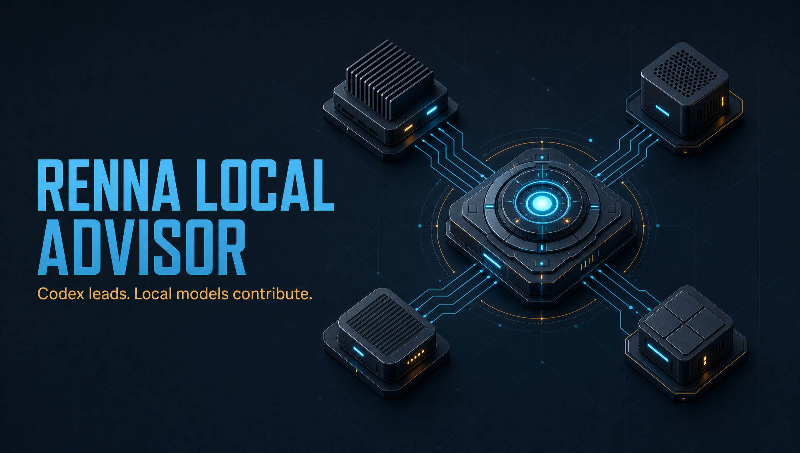
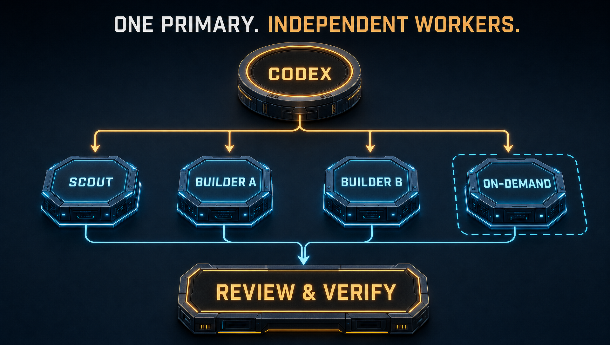
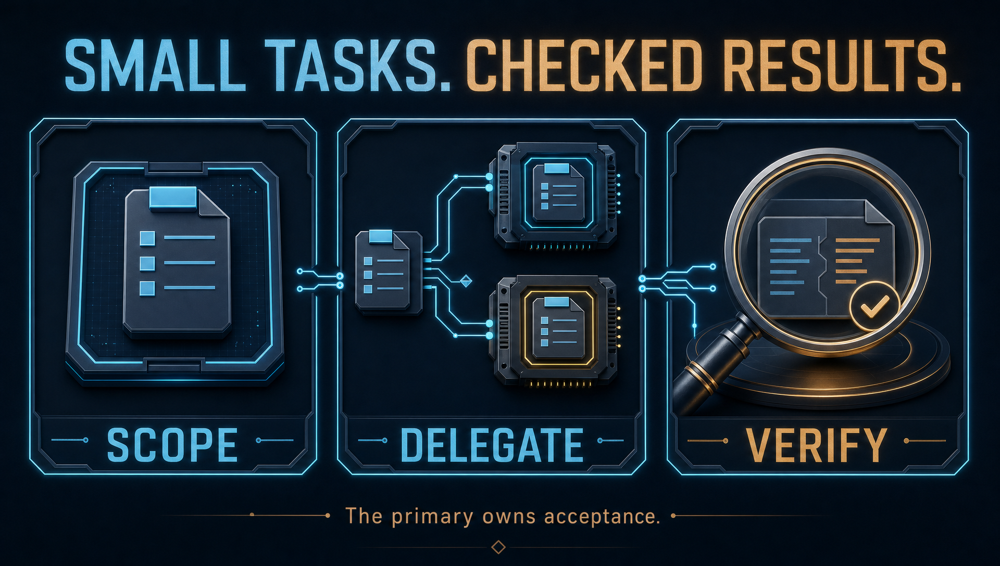

# Renna Local Advisor

Codex stays in charge. Local models take useful, bounded pieces of the work.

This is the sanitized source kit for my customized Astra/Sol Advisor setup. It
includes the modified Advisor plugins and the local-worker runtime behind them,
so you can see how the orchestration works and have Codex adapt it to your own
computer. **It is a source reference with Codex-assisted setup, not a one-command
installer.** The exported runtime launchers stop until the reference is ported.

## Start here

Clone this repository, open it in Codex, and use this prompt:

> Read SETUP.md and skills/local-advisor-setup/SKILL.md. Inspect this source kit
> and my existing local AI setup. Adapt it to the workers I actually have. Keep
> my selected Codex model and effort, preserve existing services and settings,
> keep my endpoints and credentials in private local configuration, and verify
> a disposable bounded task before enabling automatic delegation. Tell me which
> capabilities work and which still need qualification.

You do not need my hardware. Use one local worker or several independent workers
according to what is installed and useful. See [SETUP.md](SETUP.md).
The offline validation scripts require Python 3.11+ and Node.js 22+.

## How the work is divided

Conceptual topology; worker roles and counts follow the recipient's actual setup.

The primary decides the architecture, chooses tasks, reviews the complete changes,
runs the final checks, and owns acceptance. A local worker gets an exact objective,
source scope, writable ownership where needed, and explicit checks. Independent
assignments can run concurrently; shared hardware needs shared reservations.

Before choosing a cloud auxiliary or starting substantial solo work, the Advisor
considers whether a bounded local contribution would help. It records the chosen
route or a concrete skip reason in the existing checkpoint. Trivial, sequential
or already-covered work can stay solo; no worker-utilization quota is imposed.
Existing mode, primary-model and review requirements still apply.

Direct local assignments are the ordinary path. A separate local coordinator can
read, divide a genuinely decomposable project among GPU workers, inspect their
results, and return an integrated proposal. It is optional, not an extra hop every
small task has to pay for. Returned work is evidence to review, not automatic
approval. Retain useful partial work and repair the remaining defect narrowly.

## What's included

| Path | Contents |
| --- | --- |
| `advisors/astra-advisor/` | Customized Astra Advisor plugin source |
| `advisors/sol-advisor/` | Customized Sol Advisor plugin, companion roles and UltraBurn source |
| `reference-runtime/` | Actual local delegation, coordinator, isolation, lease, source-hash and application code, with machine bindings replaced |
| `skills/local-advisor-setup/` | Instructions for Codex on the recipient's computer |
| `config/local.example.json` | Empty recipient configuration template; contains no working endpoint or key |
| `SOURCE-MANIFEST.json` | Sanitized source hashes and origin labels |

The runtime is a focused source extraction, not the entire private fleet project.
Original sanitized launchers are stored as text under `launcher-templates/`; the
`bin/` files contain only the blocking guard, so even missing optional dependencies
cannot prevent a clear source-reference message.
Host-specific GPU launchers, sandbox binaries, authenticated tools, model files,
service definitions, registries, credential stores and optional client adapters
are not bundled. Private path bindings use `SETUP_REQUIRED`; destination hosts use
the reserved `.invalid` domain. Codex must adapt those integrations and verify the
result locally before removing the source-reference launch guard.

## What this does and doesn't establish

My original setup uses a large-context AMD Halo machine, two independent R9700s,
and a guarded on-demand RTX 3090. Those are examples, not required hardware.
Local models can contribute code review, source mapping, bounded implementation
and tests. Difficult or failed assignments still go back to the primary under the
user's local/cloud preferences.

I haven't measured a reliable monthly cost-saving percentage or established that
smaller models match frontier models across tasks. Routing success and a model
returning an answer do not establish answer quality. Measure completed useful work,
repair time, and the primary's verification effort on your own workload.

The public export has source-integrity, privacy-pattern and syntax checks. That
does not qualify a fresh install's real models, hardware, cancellation, tools or
desktop behavior. See [VALIDATION.md](VALIDATION.md) for the executed checks.

## Attribution and license

Astra Advisor and Sol Advisor were created by **Daniel McAteer**:

- [Original Astra Advisor](https://github.com/DannyMac180/astra-advisor)
- [Original Sol Advisor](https://github.com/DannyMac180/sol-advisor)

Their MIT copyright and license notices are retained beside both plugins. This
repository is an independently named, combined derivative source distribution;
it is not an official release from either upstream project. David Renna's additions
cover the local-fleet integration, local-first routing changes and this source kit.
See [THIRD_PARTY_NOTICES.md](THIRD_PARTY_NOTICES.md) and [LICENSE](LICENSE).
